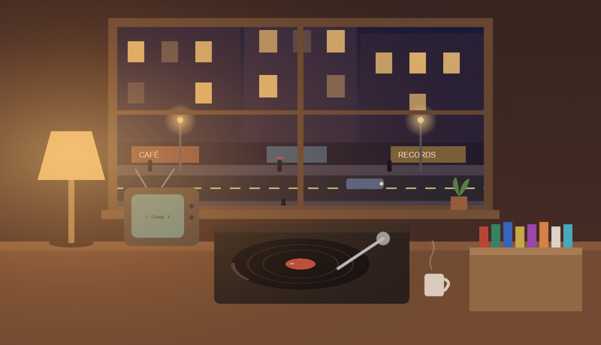
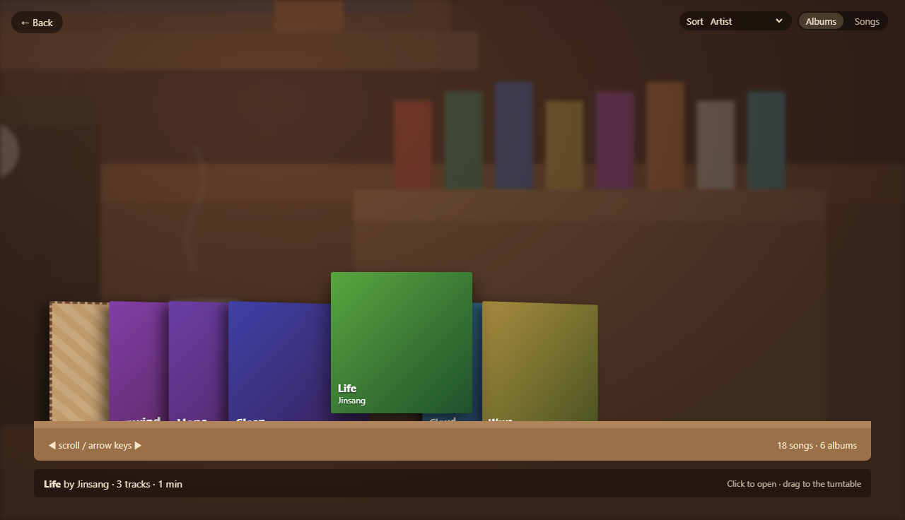
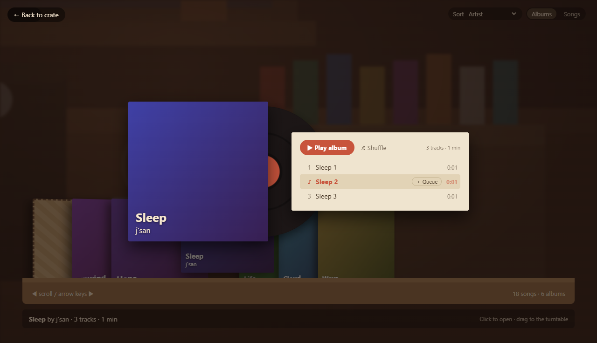
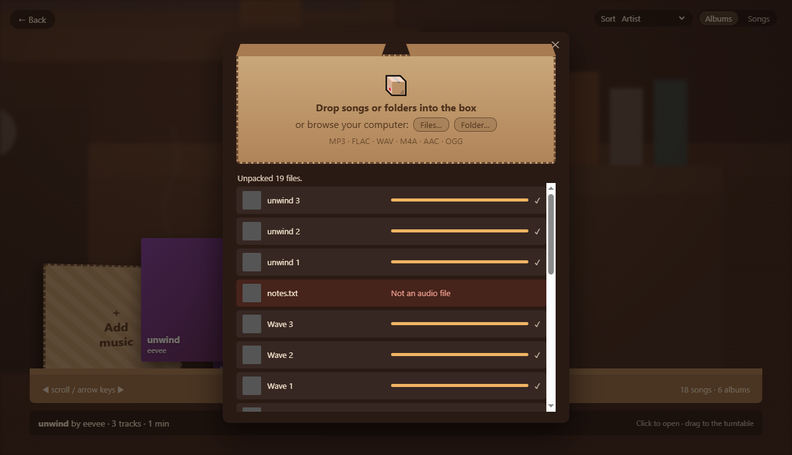

# city-flat-fm

[](https://github.com/littlewalken/city-flat-fm/actions/workflows/ci.yml)

A desktop music player that looks and feels like a cozy third-floor city apartment. There are city lights through the window, a TV in the corner, a lamp on the desk and a turntable in front of you. You play your music by interacting with the room.

> **Status:** ✅ Milestone 1 complete. Import your own music and play it in the apartment. Next up: playlists and polish (M2).



| Flip through your records | Open an album | Drop music into the box |
|---|---|---|
|  |  |  |

## Using it

- **Click any object to zoom in.** Press **Esc**, right-click or click **← Back** to zoom out.
- **Record crate:** your library. Click **＋ Add music** to open the shipping box, then drop in files or folders (MP3, FLAC, WAV, M4A, AAC, OGG) or browse for them. Files stay where they are; nothing is copied.
- **Albums:** click a sleeve to open it. **▶ Play album** plays it from the top, clicking a track starts from there, and **＋ Queue** adds a song to up next. You can also drag a sleeve onto the turntable drop zone.
- **Turntable:** play/pause, previous/next, the tonearm seek bar and volume.
- **TV:** what's playing and what's up next.
- **Lamp:** click to switch the room between warm lamplight and city glow.
- **Keys:** **Space** play/pause · **Ctrl+→ / Ctrl+←** next/previous.
- If you move or delete a song's file, it shows as *missing* in the crate's Songs list, where you can **Locate file…** or remove it. Playback skips it automatically.

## Why

Streaming services don't have everything. A lot of the music I love from smaller creators isn't on Spotify or Apple Music, so I keep it as downloaded files, scattered across folders with no good way to listen to it.

city-flat-fm brings those files into one place. Later it will also bring in my Spotify library, so local tracks and streamed tracks can share the same playlists. It's like the old days of putting any CD you owned into your PC.

## Planned features

| Milestone | Scope |
|---|---|
| **M1: The Apartment + Local Music** | The apartment scene with click-to-zoom objects, a shipping-box import screen for local files (MP3/FLAC/WAV/M4A/OGG), a record crate to browse albums, gatefold album view, turntable playback and a queue on the TV ([design spec](docs/superpowers/specs/2026-10-15-m1-apartment-local-music-design.md)) |
| **M2: Playlists + Polish** | Playlists, search via the TV, shuffle/repeat, ambient rain and city sounds, a day/night cycle |
| **M3: Room Customization** | Edit-room mode: swap the table lamp for a lava lamp, add LED ceiling strips, and more |
| **M4: Spotify** | Spotify login (Premium) via the official Web Playback SDK, with Spotify and local tracks mixed in the same playlists |
| **M5: Wallpaper Mode** | Run the apartment as an interactive live wallpaper behind the Windows desktop icons |

## How it's built

- **Main process** (Node.js): scans folders, reads tags and cover art (`music-metadata`), and stores the library in **SQLite** (`better-sqlite3`) with an automatic backup after each import.
- **Preload bridge:** the renderer gets exactly one typed object, `window.api`, via `contextBridge`. Context isolation, the sandbox and a strict CSP are on, and Node is never exposed to the UI.
- **`cfm-media://` protocol:** audio and art are served by **library id, never by path**, so the UI can't read arbitrary files.
- **Renderer:** plain TypeScript + SVG/CSS (no framework). The room is one SVG built from **slots** (lamp, ceiling) so M3 customization can swap items in. The camera zooms by animating the SVG `viewBox`.
- **PlayerEngine:** UI-free queue/transport logic behind an `AudioOutput` interface, so it's unit-tested with a fake and M4 can add a Spotify output.

Design docs: [M1 spec](docs/superpowers/specs/2026-10-15-m1-apartment-local-music-design.md) · [M1 implementation plan](docs/superpowers/plans/2026-10-15-m1-apartment-local-music.md)

## Tech stack

- **Electron** ([castLabs build](https://github.com/castlabs/electron-releases) with Widevine, so Spotify's DRM-protected playback works in M4)
- **TypeScript**
- A small **C++** native helper for wallpaper mode (M5)

## Install

Build the installer yourself (Windows):

```bash
npm install
npm run dist       # creates dist/city-flat-fm-Setup-<version>.exe
```

Run the setup file, then launch **city-flat-fm** from the Start menu or desktop shortcut. (The installer isn't code-signed yet, so Windows SmartScreen may ask you to confirm.)

## Development

Requires Windows and Node.js 24+.

```bash
npm install        # also downloads the castLabs Electron build (v44.5.1+wvcus)
npm run dev        # run the app with hot reload
npm test           # unit tests (Vitest, run under Electron's Node)
npm run test:e2e   # end-to-end tests (Playwright driving the real app, with throwaway profiles)
npm run typecheck && npm run lint
```

## Legal note

city-flat-fm plays audio files you already own, and Spotify only through Spotify's official SDK with your own Premium account. It does not download, rip or redistribute streamed music.
